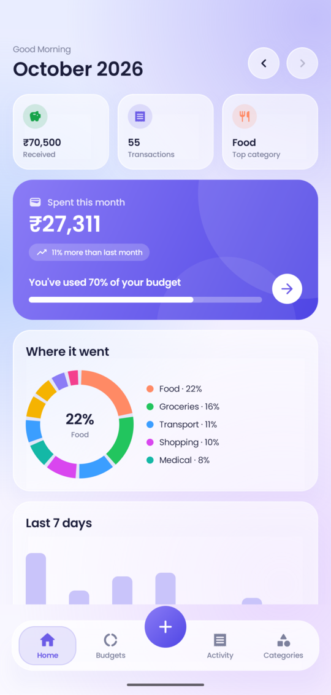
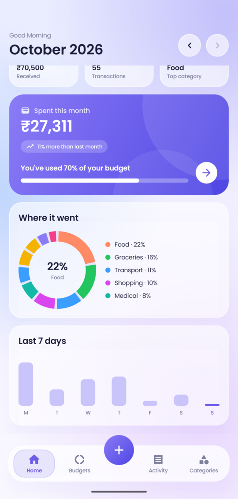
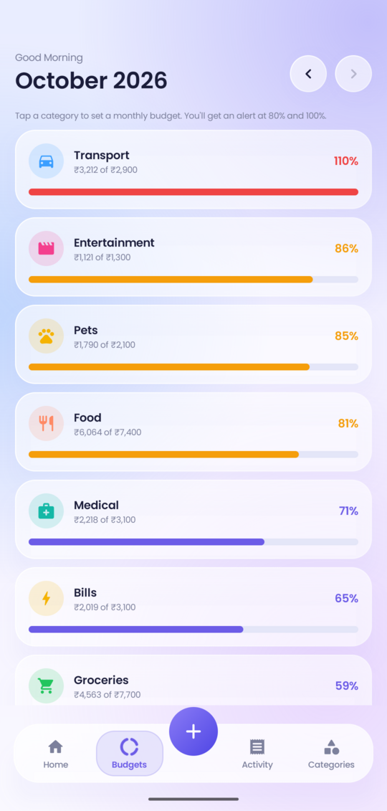
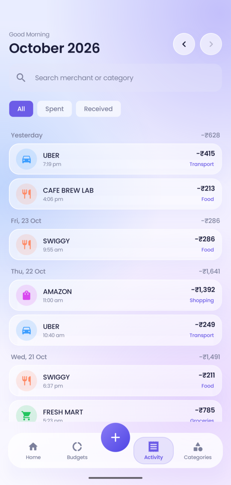
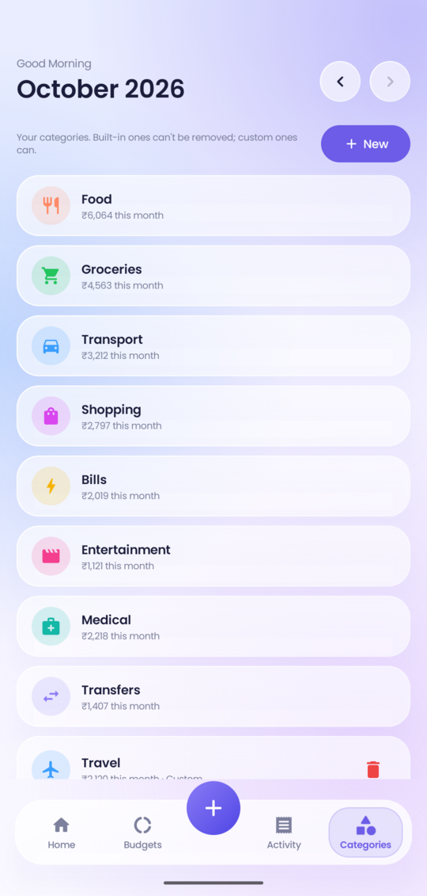
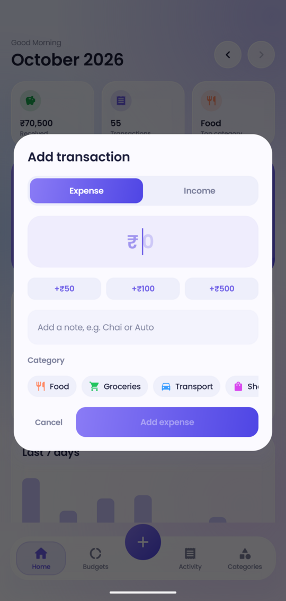

# Spendly

**Know where your money goes.** Spendly is a private expense tracker for Android that fills itself in. It reads the bank and UPI alert messages already on your phone, works out what you spent and where, and warns you before you blow a budget. No account and no cloud: your transactions never leave the phone.

> Package: `com.kk.spendly` · Android 8.0+ (API 26) · Kotlin + Jetpack Compose

---

## Screenshots

<table>
  <tr>
    <td align="center"><br><sub><b>Home</b></sub></td>
    <td align="center"><br><sub><b>Charts</b></sub></td>
    <td align="center"><br><sub><b>Budgets</b></sub></td>
  </tr>
  <tr>
    <td align="center"><br><sub><b>Activity</b></sub></td>
    <td align="center"><br><sub><b>Categories</b></sub></td>
    <td align="center"><br><sub><b>Add transaction</b></sub></td>
  </tr>
</table>

<sub>All screenshots use invented sample data, not a real account. See [Screenshots with sample data](#screenshots-with-sample-data).</sub>

## Why Spendly

Most expense trackers ask you to type every payment, or to hand your bank login to a third party. Spendly does neither. Every bank and UPI payment already sends you an SMS, so Spendly reads those on the device, turns them into transactions, and keeps everything in a local database that never leaves your phone.

## Features

**Automatic tracking**
- Reads bank, card and UPI alert SMS and extracts the amount, debit or credit, merchant or UPI ID, account and reference number.
- Scans your existing inbox once, then picks up new messages as they arrive.
- Ignores OTPs and messages from ordinary phone numbers, and collapses the duplicate alerts a single payment can trigger (for example the bank's SMS plus the UPI app's SMS).

**Categories you control**
- Ten built-in categories: Food, Groceries, Transport, Shopping, Bills, Entertainment, Medical, Transfers, Other and Income.
- Add your own with a name, an icon and a color. Remove custom ones any time.
- Change a transaction's category and Spendly remembers that merchant from then on.

**Budgets and alerts**
- Set a monthly limit per category.
- Get a notification at **80%** and again at **100%**, with a progress bar, the amount left (or over), and a one-tap jump to your budgets.
- Each warning fires once per category per month, and is delivered even if notifications were off when the threshold was crossed.

**Updates**
- Spendly checks GitHub Releases for a newer version, shows an **Update** banner with release notes and size, then downloads the APK, verifies its checksum and hands it to Android's installer.
- A once-a-day background check posts a notification when a new version is out, even if you haven't opened the app.
- Android only accepts an update signed with the same key as the installed app, so a tampered file cannot replace it.

**Everything else**
- A **+** button for cash and other payments that never send an SMS. Pick the date too, so yesterday's chai can be added today.
- **Edit or delete manual entries** any time: wrong amount, note, date or category is a two-tap fix. Transactions parsed from SMS can't be edited, only recategorised, so they always match your bank.
- **Tap any transaction** for a full view: exact amount, date and time, account, reference number and its category. For SMS-based ones it also shows the **original message** in a chat-style card.
- Home dashboard: spent this month, received, transaction count, top category, comparison with last month, a category donut and a 7-day chart.
- Activity list grouped by day, with search and Spent / Received filters.
- Browse previous months.
- Frosted-glass interface with Poppins typography and smooth transitions.

## Privacy

- **Internet is used for one thing only:** asking GitHub for the latest release and downloading it when you tap **Update**. No transactions, messages, identifiers or analytics are ever sent, and there is no tracking or advertising code. As with any web request, GitHub can see your IP address.
- All data is stored in a local Room (SQLite) database on the device.
- Cloud backup and device-to-device transfer are disabled for the app's data.
- Only messages from alphanumeric bank sender IDs are parsed. The message text is **not stored**: when you open a transaction, Spendly looks the message up in your phone's inbox at that moment to show it, and keeps no copy. If you delete the SMS, the card says it can't be found.

Permissions requested:

| Permission | Why |
|---|---|
| `READ_SMS`, `RECEIVE_SMS` | find and parse transaction alerts |
| `POST_NOTIFICATIONS` | budget alerts and update notices |
| `INTERNET` | check GitHub for a new release and download it |
| `REQUEST_INSTALL_PACKAGES` | let you install a downloaded update (Android also asks you to allow this once) |

## Tech stack

| Area | Choice |
|---|---|
| Language | Kotlin 2.0 |
| UI | Jetpack Compose, Material 3, Material Icons |
| Storage | Room 2.6 with Kotlin Flow |
| Background work | A manifest `BroadcastReceiver` for incoming SMS, WorkManager for the daily update check |
| Typeface | Poppins |
| Build | Gradle (Kotlin DSL), Android Gradle Plugin 8.7, KSP |
| Targets | `minSdk 26`, `targetSdk 35` |

## Project layout

```
app/src/main/kotlin/com/kk/spendly/
├── parser/   SmsParser.kt, Categorizer.kt      SMS text -> transaction, merchant -> category
├── data/     Db.kt                             Room entities, DAO, migrations, repository
├── sms/      SmsReceiver.kt, BudgetAlerts.kt   incoming SMS, inbox backfill, budget notifications
├── update/   Updater.kt, UpdateWorker.kt,      GitHub release check, download + install,
│             InstallReceiver.kt                daily check and update notification
└── ui/       MainActivity.kt, Screens.kt,      view model, screens and dialogs,
              Charts.kt, Theme.kt, Splash.kt    charts, glass theme and typography, intro
app/src/test/kotlin/com/kk/spendly/             parser, categorizer and updater unit tests
docs/screenshots/                               README screenshots (sample data only)
tools/seed_demo_db.py                           sample data for the demo build
```

## Build and run

You need JDK 17 or newer and the Android SDK (platform 35).

```bash
# tell Gradle where the Android SDK is
echo "sdk.dir=$HOME/Android/Sdk" > local.properties

# run the unit tests
./gradlew testDebugUnitTest

# build a debug APK and install it on a connected phone
./gradlew assembleDebug
adb install -r app/build/outputs/apk/debug/app-debug.apk
```

On first launch, tap **Allow SMS access** so Spendly can read your alerts, and allow notifications to receive budget warnings.

If Android blocks the SMS permission for a sideloaded app, open the app's info screen and choose **Allow restricted settings** first.

### Signed release build

Create `keystore.properties` in the project root (it is git-ignored, never commit it or your keystore):

```properties
storeFile=release.keystore
storePassword=<your store password>
keyAlias=<your key alias>
keyPassword=<your key password>
```

Then:

```bash
./gradlew assembleRelease bundleRelease
```

The release build is minified and resource-shrunk. Outputs land in `app/build/outputs/apk/release` and `app/build/outputs/bundle/release`.

## Screenshots with sample data

Screenshots must never come from a real phone, so the project has a separate **demo** build. It installs next to the normal app as `com.kk.spendly.demo` with its own empty database, never reads SMS and never goes online. `tools/seed_demo_db.py` fills that database with made-up transactions, two custom categories and budgets.

```bash
./gradlew assembleDemo
adb install -r app/build/outputs/apk/demo/app-demo.apk

# open the demo app once so it creates its database, then close it
adb shell am force-stop com.kk.spendly.demo
for f in expenses.db expenses.db-wal; do
  adb exec-out "run-as com.kk.spendly.demo cat databases/$f" > "/tmp/$f"
done

python3 tools/seed_demo_db.py /tmp/expenses.db
rm -f /tmp/expenses.db-wal

adb shell "run-as com.kk.spendly.demo sh -c 'rm -f databases/expenses.db-wal databases/expenses.db-shm; cat > databases/expenses.db'" < /tmp/expenses.db
```

Open the demo app and capture the screens with `adb exec-out screencap -p`. Crop off the status bar, which shows the real phone's notifications and clock, and uninstall the demo app afterwards with `adb uninstall com.kk.spendly.demo`.

## Publishing an update

Installed copies find new versions through GitHub Releases:

1. In `app/build.gradle.kts`, raise `versionName` (for example `1.1.0`) **and** `versionCode`. Android refuses an update whose `versionCode` is not higher.
2. Build the signed APK: `./gradlew assembleRelease`.
3. On GitHub, create a release tagged `v1.1.0` (matching `versionName`), write short notes, and attach `app-release.apk`. The first line of the notes that is not a heading appears in the update banner.
4. Always sign with the **same keystore**. Android will not install an update signed with a different key, and a lost key means existing users can never update. Keep a backup of it somewhere safe.

The repository checked by the app is the `REPO` constant in `update/Updater.kt` (`owner/repo`); change it if you fork the project.

## Limitations

- **Android only.** iOS does not let apps read SMS.
- **SMS-dependent.** A bank that doesn't send an alert for a payment won't appear. Use the **+** button for those.
- **Message formats vary by bank.** The parser uses general patterns that cover common formats, tested against sample messages, and categories come from keyword matching. If a message from your bank is missed or mis-read, see below.
- **Google Play restricts SMS permissions** to specific approved use cases, so distributing through the Play Store requires a permissions declaration. Sideloading the APK works without one.
- **In-app updates are for sideloaded installs.** A copy installed from an app store should be updated by that store, and Play's policies restrict apps that install other APKs.

## Contributing

The most useful contribution is teaching the parser a bank format it misses:

1. Add a test with a sample message (with any account numbers and names replaced) to `SmsParserTest.kt`.
2. Adjust `SmsParser.kt` until it passes.
3. Run `./gradlew testDebugUnitTest`.

Keyword lists for merchant categories live in `Categorizer.kt`.

Never include real account numbers, names or transaction details in issues, tests or screenshots.

## Credits

- [Poppins](https://github.com/itfoundry/Poppins) typeface, licensed under the SIL Open Font License 1.1 (full text in [licenses/Poppins-OFL.txt](licenses/Poppins-OFL.txt)).
- [Material Icons](https://fonts.google.com/icons) by Google, licensed under Apache 2.0.
- Built with [Jetpack Compose](https://developer.android.com/jetpack/compose) and [Room](https://developer.android.com/training/data-storage/room).

## License

Spendly is released under the [MIT License](LICENSE). The bundled Poppins font keeps its own license, linked above.
